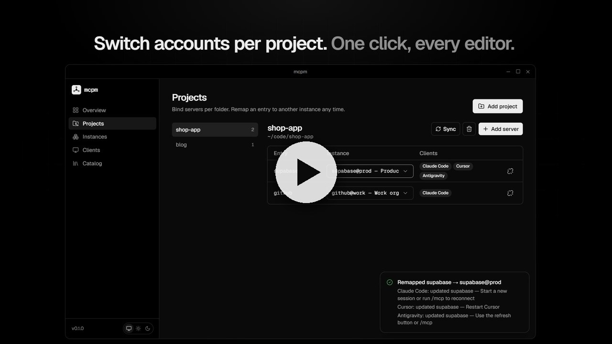

# mcpm

**One desktop app to manage MCP servers across every AI IDE and CLI.**

[Website](https://srikrishnan2004.github.io/mcpm/) · [Watch the demo](https://srikrishnan2004.github.io/mcpm/#demo) · [Design doc](docs/DESIGN.md)

[](https://srikrishnan2004.github.io/mcpm/#demo)

<sub>▶ Click to watch the 60-second demo, or [download the MP4](site/demo.mp4).</sub>

Claude Code, Cursor, VS Code, Windsurf/Devin Desktop, Antigravity, Gemini CLI, Claude Desktop, Codex… each keeps MCP servers in its own file and format. mcpm gives you one registry, **named instances** of the same server (`supabase@client-a`, `supabase@personal`), and **per-project remapping** — without copying tokens into config files.

```
supabase  →  [ supabase@client-a ▾ ]   Claude Code · Cursor · VS Code
```

## How it works

- **Instances**: a server template + settings + credentials. Credentials live only in the OS keychain (Windows Credential Manager, macOS Keychain, Linux Secret Service).
- **Projects**: bind an entry name (`supabase`) to an instance per folder. mcpm writes the entry into each selected client's project config (`.mcp.json`, `.cursor/mcp.json`, `.vscode/mcp.json`, …).
- **Shim**: every written entry is just `mcpm run <instance>`. At launch the shim reads secrets from the keychain and starts the real server. Config files stay secret-free and safe to commit.
- **Safe writes**: mcpm only touches entries it owns, refuses to overwrite yours, and backs up every file before writing.

See [docs/DESIGN.md](docs/DESIGN.md) for the full architecture.

## Status

Early scaffold (v0.1). Working today:

- Core: registry, catalog, keychain secrets, template rendering, project sync with backups + ownership manifest
- Adapters: Claude Code, Claude Desktop, Cursor, VS Code, Windsurf/Devin, Antigravity, Gemini CLI (JSON). Codex (TOML) is next.
- CLI: `mcpm run | list | clients | secret-set | sync`
- Catalog: 38 server templates (see below)
- Desktop UI: Overview, Projects (bind / remap / unbind), Instances, Clients, Catalog

## Catalog

Built-in templates in [`catalog/servers/`](catalog/servers), each pointing at the vendor's official server where one exists:

| Area | Servers |
|---|---|
| Code & dev tools | GitHub, GitLab, Sentry, Linear, Atlassian (Jira/Confluence), Context7, Playwright, Chrome DevTools, Git |
| Databases & backend | Supabase, Postgres, Neon, MongoDB, Redis, Firebase, Airtable |
| Cloud & deploy | Cloudflare, Vercel, Netlify, Heroku, Docker, AWS Documentation, Grafana, Stripe |
| Search & web | Brave Search, Exa, Tavily, Perplexity, Firecrawl, Fetch |
| Productivity & AI | Notion, Slack, Figma, Hugging Face |
| Utilities | Filesystem, Memory, Sequential Thinking, Time |

Requirements by launcher: `npx` needs Node 20+; `uvx` (Fetch, Git, Time, Postgres, Redis, Grafana, AWS Documentation) needs [uv](https://docs.astral.sh/uv/); Docker and GitHub need Docker. Remote OAuth servers (Linear, Notion, Atlassian, GitLab, Neon, Cloudflare, Vercel) run through [`mcp-remote`](https://github.com/geelen/mcp-remote) and open a browser sign-in on first launch. Figma needs the Figma desktop app with its MCP server enabled.

## Development

Prerequisites: Rust (stable), Node 20+, pnpm, and the [Tauri prerequisites](https://v2.tauri.app/start/prerequisites/) for your OS.

```sh
# Rust tests
cargo test --workspace

# Desktop app (dev)
cd apps/desktop
pnpm install
pnpm tauri dev

# CLI
cargo run -p mcpm-cli -- list
```

Set `MCPM_HOME` to use a throwaway data directory while developing.

> The shim must be on your `PATH` as `mcpm` for project configs to launch servers. During development: `cargo install --path crates/cli`.

## Layout

```
crates/core      mcpm-core: model, registry, catalog, secrets, adapters, sync
crates/cli       `mcpm` binary: launcher shim + CLI
apps/desktop     Tauri v2 app (React + TypeScript + Tailwind)
catalog/         server templates (JSON) + schema
docs/            design docs
```

## Contributing

New servers and new client adapters are the most valuable contributions. See [CONTRIBUTING.md](CONTRIBUTING.md).

## License

Dual-licensed under [MIT](LICENSE-MIT) or [Apache-2.0](LICENSE-APACHE), at your option.

The UI follows the visual language of Vercel's Geist design system and uses the [Geist font](https://github.com/vercel/geist-font) (SIL OFL 1.1). mcpm is not affiliated with Vercel.
